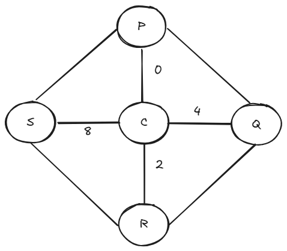

# 1A: rks746

GitHub username: rks746  
According to the algorithm,  
r = 18  
k = 11  
s = 19  
7,4,6 as they are 

18x1 + 11x2 + 19x4 + 7x8 + 4x16 + 6x32 = 18 + 22 + 76 + 56 + 64 + 192  

Enigma number (E) = 428  

## 1A: The bridges of your city

My last 4 digits: 0428

My map: Since, no odd number, no extra bridges added. 
8 bridges in total.

My guess: No, the walk is not possible, since atleast one bridge should be crossed twice to cover all bridges. 

### Attempt 1:-  
P -> Q -> C -> P -> S -> C -> R -> Q  
stuck at Q (S-R bridge not covered)

### Attempt 2:-  
P -> Q -> C -> P -> S -> R -> C -> S  
stuck at S (Q-R bridge not covered)

### Attempt 3:-  
C -> Q -> R -> S -> P -> C -> R  
stuck at R (C-S, P-Q bridges not covered)

### Table
| Island | Count |
| :---: | :---: |
| C | 4 |
| P | 3 |
| Q | 3 |
| R | 3 |
| S | 3 |

A walk covering all bridges only once is not possible.   

### Why
Most islands have odd number of bridges. An intuition is that if one travels to an island, comes out, and then again goes in, he/she will have to repeat a bridge to come out thus voilating the condition. It would have been fine if that island was last, but all 4 islands having degree 3 cannot be last. 

Euler's theorem states that a connected graph has an Eulerian trail if and only if it has either 0 or exactly 2 vertices of odd degree. (either first or last vertices)  
In this case, there are 4 odd degree vertices.

Thus, my attempts failed to cover all bridges once and this was confirmed by the count table.
